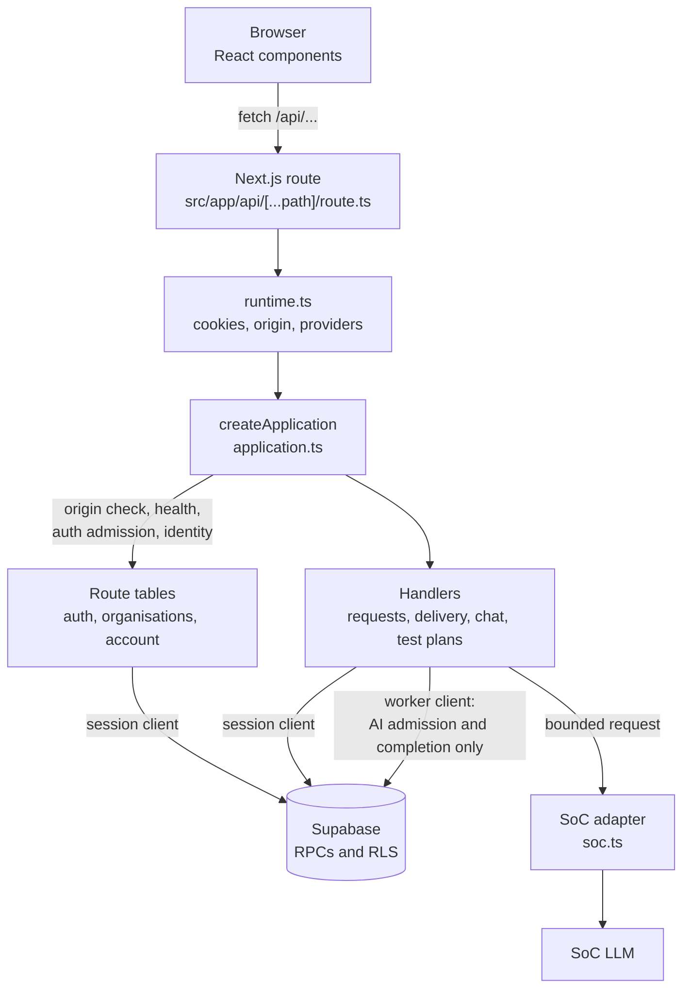
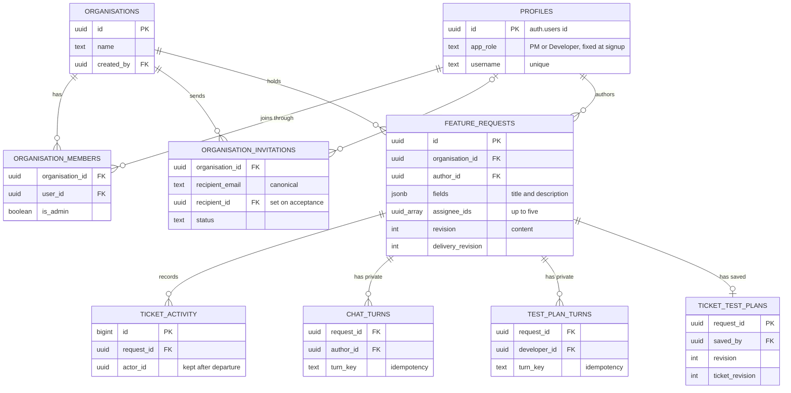
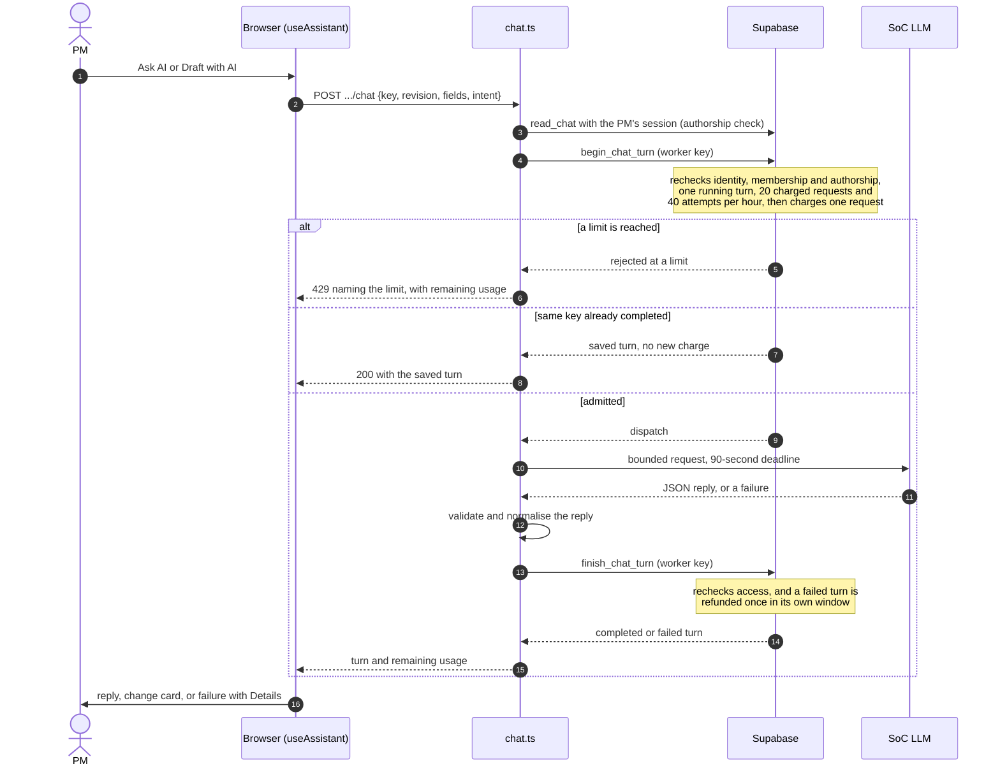

# SpecForge Developer Guide

SpecForge is a Next.js and Supabase application for organisation ticket
workflows, with SoC-assisted ticket drafting for product managers and test plans
for developers. This guide is for people changing or deploying it; the
[User Guide](UserGuide.md) describes the product.

## Contents

1. [Setup](#setup): [local setup](#local-setup), [migrations](#applying-migrations)
2. [Architecture](#architecture): [request flow](#request-flow),
   [modules](#modules-and-interfaces), [endpoints](#endpoint-reference),
   [client-side behaviour](#client-side-behaviour)
3. [Data model](#data-model): [tables](#tables-and-relationships),
   [membership](#membership-storage), [tickets](#ticket-storage)
4. [Security](#security)
5. [AI features](#ai-features): [one PM AI turn](#one-pm-ai-turn),
   [PM assistant](#pm-assistant), [Developer test plans](#developer-test-plans),
   [observed provider behaviour](#observed-provider-behaviour)
6. [Testing](#testing): [checks](#checks), [test layers](#test-layers),
   [focused checks](#focused-checks)
7. [Deployment](#deployment): [environments](#deployment-and-environments),
   [release check](#release-check), [first-time setup](#first-time-setup)
8. [Process](#process): [workflow folder](#workflow-folder),
   [acknowledgements](#process-and-acknowledgements)

## Setup

### Local setup

Requirements: Node.js 22, npm, Docker Desktop running. Node 22 is the version
the deployment target supports, so local, CI and both environments run the same
major; `engines` pins 22.x, which Render also reads to pick the build's Node. Dependencies are
locked in `package-lock.json`. Supabase CLI is pinned to the compatible 2.121.0
line; CLI 3 rejected the legacy inbox configuration during setup.

```sh
npm ci
npm run db:start
npm run db:env
npm run dev
```

Open <http://localhost:3000>. Local Supabase uses API port 55321, database 55322,
Studio 55323 and captured email inbox 55324. Source, configuration and migrations
live under `src/supabase/`. `db:start` applies migrations to a fresh local stack;
`npm run db:reset` reapplies them by clearing **only disposable local data**.
`npm run db:stop` stops the local stack. Wrappers refuse additional arguments and
suppress CLI output that can contain generated local credentials. When a command
fails, the tail of that output is relayed with credential-shaped values redacted,
because a failure with no reason at all cannot be diagnosed in CI.

`db:env` updates ignored `.env.local` with local Supabase public values, the
server-only local AI worker key and `APP_ORIGIN`, preserving unrelated settings
and writing atomically with mode 0600. It does not change `.env` or copy a hosted
project's key. Next.js gives `.env.local` precedence over `.env`; remove or
replace it deliberately when switching to a hosted development project. Ordinary
account and task paths use the public session client. Trusted AI turn admission
and completion alone require server-only `SUPABASE_SECRET_KEY`. `.env.example`
documents the server-only SoCLaaS settings both AI features use; routine tests
make no live model requests.

### Applying migrations

For an existing local stack, apply additive migrations without resetting data:

```sh
npx supabase migration up --local --workdir src
```

Never use hosted flags for local testing. `db:start` is for starting the stack;
it is not a migration runner for an already-running database. Hosted
environments receive migrations from the deployment workflow.

## Architecture

### Request flow



Every `/api` request goes through one `createApplication`. Ordinary reads and
writes use a client bound to the user's session, so PostgreSQL row-level security
and RPC checks apply exactly as they would to any other client. Only AI turn
admission and completion use the server-only worker key, and those RPCs recheck
identity and membership themselves.

### Modules and interfaces

- `src/server/application.ts`: `createApplication`, the single `/api` entry
  point. It runs the origin check, the public health check, auth admission and
  the identity check in that order, then dispatches to route tables. Its small
  request/response interface covers validation, authorisation and safe failures.
- `src/server/routes.ts`: the route table type `{ method, pattern, handler }` and
  `matchRoute`. The first matching entry wins, so each table's order is part of
  its behaviour.
- `src/server/auth.ts` (sign-up, sign-in, verification, resend, sign-out and auth
  admission), `src/server/organisations.ts` (organisations, membership and
  invitations) and `src/server/account.ts` (profile and username) hold the routes.
- `src/server/requests.ts`: strict request lifecycle HTTP actions and safe results.
  `src/server/http.ts` shares bounded JSON and private response handling.
- `src/server/delivery.ts` owns delivery HTTP validation and safe errors;
  `ticket-schemas.ts` shares request output and filter schemas.
- `src/server/chat.ts` and `src/server/test-plans.ts` orchestrate the two AI
  features; `src/server/soc.ts` is the bounded SoC adapter.
- `src/server/runtime.ts`: Next.js/Supabase SSR adapter, request-scoped cookies
  and bounded outbound fetch. Normal calls use the public key and user session.
- `src/app/api/[...path]/route.ts`: binds that interface to Next.js handlers.
- `src/components/`: shared account forms, workspace, form controls, notices and
  client HTTP handling. `src/app/globals.css` owns shared theme tokens.
- `src/supabase/migrations/`: fixed roles, initial profile provisioning, RLS and
  transactional organisation creation, invitations and member administration.
  Storage authorisation remains effective when clients bypass Next.js.
- `src/tests/`: HTTP behaviour tests, real local database integration checks and
  browser journeys. `src/tooling/` holds local-only setup, test and screenshot
  adapters.

### Endpoint reference

All paths start with `/api`. "Member" means a signed-in, email-verified member of
that organisation; other callers get 401 (not signed in) or 403 (not verified, or
no permission). Every route can also answer 503 when Supabase fails or AI is not
configured, and every mutation needs the exact `APP_ORIGIN` (403 otherwise). A
failed SoC call is not a 503: it comes back as a failed, refunded turn.

| Method | Path | Who may call it | Main statuses |
| --- | --- | --- | --- |
| GET | `/health` | Anyone | 200, 503 |
| POST | `/auth/signup`, `/auth/verify`, `/auth/signin`, `/auth/resend` | Anyone; 30 per minute per server instance | 200 or 202, 400, 401 (sign-in), 429 |
| POST | `/auth/signout` | Anyone | 200 |
| GET, POST | `/account` | Signed in | 200, 400, 409 (username taken) |
| GET, POST | `/organisations` | Signed in | 200, 201 (created), 400 |
| GET | `/organisations/[org]` | Member | 200, 404 |
| GET | `/invitations` | Signed in | 200 |
| POST | `/invitations/[id]` | The invited account | 200, 400, 403, 409 |
| GET | `/organisations/[org]/members` | Admin | 200, 403 |
| GET, POST | `/organisations/[org]/invitations` | Admin | 200, 202 (invited), 400, 409, 429 |
| POST | `/organisations/[org]/invitations/[id]` | Admin | 200, 400, 403, 409 |
| POST | `/organisations/[org]/members/[userId]` | Admin; any member for `leave` | 200, 400, 403, 409 |
| GET, POST | `/organisations/[org]/requests` | Member; PMs create | 200, 201 (created), 400, 403 |
| GET, POST | `/organisations/[org]/requests/[id]` | Members read published tickets; the author edits | 200, 400, 403, 404, 409 |
| POST | `/organisations/[org]/requests/[id]/delivery` | Author, or an assignee for status | 200, 400, 403, 409 |
| GET, POST | `/organisations/[org]/requests/[id]/activity` | Member, published tickets | 200, 400, 403, 409, 429 |
| GET | `/organisations/[org]/ticket-members` | Member | 200, 400 |
| GET, POST | `/organisations/[org]/requests/[id]/chat` | The ticket's PM author | 200, 202 (running), 400, 403, 409, 429 |
| GET, POST, PUT | `/organisations/[org]/requests/[id]/test-plan` | Developers generate and save; members read the saved plan | 200, 202 (running), 400, 403, 409, 429 |

The sections below give each group's request and response shapes.

#### Accounts and organisations

Account POSTs are `/api/auth/signup`, `/verify`, `/signin`, `/signout`, `/resend`.
JSON is bounded to 8 KiB. Signup requires `username` for both roles. The app
passes the lowercase value through Supabase Auth signup metadata. The existing
account-creation trigger validates it and writes `profiles.username` in the
signup transaction. PostgreSQL `NOT NULL` and `UNIQUE` constraints enforce the
requirement across all profiles. The additive migration assigns reserved
`legacy_` usernames to existing profiles. Sign-in and verification use email.
`GET /api/account` returns verified account identity, role, username and Auth
`createdAt` from the protected profile.

The app gives the same signup response for accepted requests and ambiguous Auth
provisioning failures, with guidance to try a different username if no verification email
arrives. The raw Supabase Auth signup endpoint may return different statuses for
a username collision and an existing email because repeat signups can skip the
profile trigger. This difference remains visible to callers of that endpoint.

Same-origin `POST /api/account` accepts only `{username}` and returns the current
account. The session-bound `rename_username(new_username)` RPC independently
checks verified identity and updates only its own profile username. Table update
grants remain closed; format, reserved-prefix checks and atomic uniqueness are
enforced in PostgreSQL. Email, application role and creation date cannot be
edited.

`GET/POST /api/organisations` list and create; `GET /api/organisations/[id]`
selects a member-visible organisation.

#### Membership

The approved [membership slice](../workflow/specs/2026-11-07-organisation-membership.md)
adds:

- `GET /api/invitations`; `POST /api/invitations/[id]` with `action`
  accept/decline.
- `GET /api/organisations/[id]/members` (admins only).
- `GET/POST /api/organisations/[id]/invitations`; POST accepts `email`.
- `POST /api/organisations/[id]/invitations/[invitationId]` with cancel/resend.
- `POST /api/organisations/[id]/members/[userId]` with remove/promote/demote/leave.

Invite and manage RPCs return structured status outcomes (`created`, `pending`,
`member`, `limited`, `resent`, `cancelled`) so expected validation preserves
quota increments. HTTP maps `limited` to 429 and `member` to 409. Creation and
duplicate responses return truthful messages at 202; withdrawal returns its
message at 200. Other RPC failures map to 400 (validation), 403 (permission), 409
(transition conflict) or 503 (service failure), without raw error messages.
Admin rosters and invitation lists are capped at 100; pagination is still a
release/scale limitation. Invitations are in-app; no SMTP or service-role key is
needed for them.

#### Tickets and delivery

Storage and HTTP `fields` contain exactly `{title, description}`; limits are
160 and 24,000 Unicode code points. Create, read, list, save, submit and delete
actions use revision conflicts. Request JSON allows 192 KiB, enough for valid
content plus JSON escaping; account and membership endpoints keep 8 KiB.

- `GET /api/organisations/[org]/requests` uses `list_ticket_page`: 50 entries,
  `nextOffset`, filters `search/status/priority/assignee/overdue/today/sort` and
  `offset`. Filtering occurs before pagination; `today` is the viewer's ISO
  calendar day for overdue filtering. Sort accepts `updated`, `due`, or `status`
  (statuses are grouped before pagination, with Done last). Offset pages reflect
  live updates, so a refresh is needed if concurrent edits reorder results.
  Legacy `list_requests` remains a capped compatibility RPC; the UI does not use
  it.
- `POST .../requests` with `{creationKey}` creates a private draft.
  `POST .../requests/[id]` takes one of `save_draft`, `submit`,
  `save_published` or `delete_draft`, with the expected revision.
- Content mutations accept optional `delivery: {revision, changes}`. When
  supplied, `save_ticket` locks the authored request, checks both revisions, then
  composes `update_delivery` and `save_draft`/`publish_request` in one
  transaction. Validation or conflicts roll back all writes and activity. Empty
  changes still check the delivery revision. Publish and Update send the legacy
  `acknowledged: true` compatibility field.
- `POST .../requests/[id]/delivery`: `{revision, changes}`; strict optional change
  keys `due_date/priority/assignee_ids/status`. `update_delivery` locks
  organisation then ticket, checks current identity, membership and
  author/assignee permissions, and conditionally increments the delivery
  revision without changing the content revision. Assigned readers use it, with
  an Update button, to change status.
- `GET /api/organisations/[org]/ticket-members?search=&after=&selected=`:
  `ticket_members` returns up to 50 current members as
  `{user_id, email, app_role, username}`, `next_cursor`, and up to five
  independently resolved `selected_members`. Email search is case-insensitive
  literal substring matching, capped at 160 characters, and runs before paging.
  `selected` is comma-separated UUIDs (maximum five), so selected labels resolve
  independently of search and cursor. All members can use this lookup;
  membership management remains admin-only.
- `GET .../requests/[id]/activity?before=`: `read_ticket_activity` uses
  descending bigint IDs serialized as strings, 50 entries and `next_cursor`.
- `POST .../requests/[id]/activity`: `{creationKey, body}`; `comment_ticket`
  derives the actor, requires publication and current membership, enforces 4,000
  code points and 20 creations per member per minute per organisation. Identical
  idempotency retries do not consume quota; changed text with the same key
  conflicts. Bodies are capped at 32 KiB.

The AI routes are described under [AI features](#ai-features).

### Client-side behaviour

#### Shared action notifications

RootLayout mounts the client NotificationProvider from
`src/components/notifications.tsx`. Call `useNotifications().notify(message,
danger?)` for transient action feedback. `useNotificationState` adapts string
state that must still gate recovery controls; expiry removes the global banner
only, not the local recovery state. Do not use this adapter for text input or
ongoing field validation. NotificationBanner owns presentation; the provider owns
event identity, replacement and three-second timer cleanup. Error events use red
alert styling and informational events use polite status styling. Repeated
identical events restart the timer without overlap.

The shared `Modal` (used by organisation management and AI change review)
registers its native top-layer element explicitly so notifications from anywhere
remain visible above the modal. Host changes preserve the deadline. Keep
persistent save/conflict state, field guidance and saved AI history contextual.

#### Session expiry

`api` in `src/components/http.ts` is the one place that recognises an ended
session: a 401 from any call outside `/api/auth/` (sign-in answers rejected
credentials with 401). `onSessionChange(listener)` reports `false` on such a 401
and `true` once a non-auth call or sign-in succeeds again. RootLayout mounts
`SessionBanner` from `src/components/session.tsx` once below the header; it shows
the persistent alert with a plain **Sign in again** link (a document navigation,
so editor departure guards apply) and never redirects. On the public pages (`/`,
`/sign-in`, `/sign-up`, `/verify-email`) the account menu's check is expected to
fail, so a 401 there hides the banner instead, including one carried over by the
workspace or profile client redirect. Components do not special-case 401 except
to stop retrying: the editor turns it into a retryable problem that halts
autosave, and the workspace and profile pages keep their redirect. A 403 remains
an in-place "no permission" outcome.

#### Ticket editor and layout

The approved [layout spec](../workflow/specs/2026-11-08-ticket-layout.md) removes
visible ticket references and the duplicated author-page title heading. Internal
numbers, routes and compatible search/storage interfaces remain unchanged.
`TicketDeliveryFields` renders compact fields below Title and is controlled by
the author editor; `TicketDelivery` handles assigned-reader status edits.
`CopyTicketLink` lives in the compact navigation row. The Title and due-date
inputs associate with the ticket form by native `form` attributes. Title and
description required validation runs on Publish; due date is optional.
Incomplete draft autosaves bypass form validation. Whitespace and limit failures
show on-demand validation. Idle Publish is clickable; busy or conflicted actions
remain blocked.

The [whole-ticket spec](../workflow/specs/2026-11-08-ticket-autosave.md) makes
author drafts autosave all editable fields; Publish and Update save the whole
ticket, and published metadata remains local until Update. The author editor owns
delivery state and navigation protection alongside text. Its lost-response check
compares content, publication state, delivery values and both expected revisions
before reporting success. Recovery controls appear only after failures. Native
editor entry and departure guards protect unsaved work during navigation.

`ChatPanel` owns a two-column layout: main ticket content plus a collapsible,
initially open AI sidebar. Collapsing uses `hidden`, preserving the mounted
conversation and instruction. See [PM assistant](#pm-assistant) for what the
sidebar holds.

The [visibility spec](../workflow/specs/2026-11-08-ticket-visibility-banner.md)
adds `TicketVisibility` along the top inside edge of the left ticket card, above
Title. Navigation remains above the card, with a shared Lucide ArrowLeft on Back
to requests. `RequestScreen` loads the organisation name from the authorized
organisation GET; no banner is rendered until ticket, account and organisation
have loaded. Reader and author views share the same banner; author visibility
follows saved state, including recovery after an ambiguous Publish. Local
published edits do not change the banner. The static About this ticket section
shows metadata at the bottom of the ticket card, beneath author actions or the
reader refresh action and before team discussion. The author save status sits
below the metadata. Draft content saves record `last_autosaved_at`, which
survives delivery-only updates and is cleared on publication. Older drafts with
no recorded autosave time and published tickets show Last saved using
`updated_at`. Draft delivery status is a disabled To do select, distinct from
visibility.

#### Shared controls

- **Icons.** `lucide-react` is pinned to 1.70.0 (ISC), with named static imports,
  decorative `aria-hidden` SVGs and shared `.ui-icon` size and stroke tokens. Use
  the same library and style for future icons; no runtime CDN or network
  fetching.
- **Pill dropdowns.** The shared library exports `Dropdown`, `DropdownOption`,
  `Pill` and `PillTone`; see `workflow/ui.md` for the fixed-choice interface and
  keyboard behaviour. Ticket status and priority use its controlled pill
  dropdowns; reader fields and list badges reuse `ticket-pills.tsx` so labels and
  tones stay consistent. Priorities are low, medium and high.
- **Email assignee picker.** Ticket authors type part of a member's email into
  the Assignees box. A scrollable suggestion list supports Arrow Up/Down, Enter,
  Escape and mouse selection. Selected emails appear as removable chips; the
  five-assignee limit applies. Draft selections follow autosave; published
  changes require Update. Search for your own email to assign yourself.
  Assignment storage and permissions use UUIDs.
- **Date picker.** Due dates use the shared controlled `DatePicker` from `ui.tsx`,
  wrapping `@daypicker/react` 10.0.2 (MIT, with date-fns and @date-fns/tz,
  installed from npm with lockfile integrity and lifecycle scripts disabled; no
  runtime assets are fetched). The popover owns pending exact-date text; only
  valid Apply, day or Today selections emit a `YYYY-MM-DD` string, and Clear
  emits null. Local full-year construction and calendar-field checks preserve
  years 0001–9999 and avoid UTC date shifts. Invalid input preserves the
  committed date; closing cancels unapplied text. The library stylesheet loads
  once in the root layout before the purple theme overrides. Shared Button has
  its own module to avoid a circular import between the UI barrel and DatePicker.
- **Profile page.** `/profile` composes the shared account menu, controls and
  unsaved-change guard. The navbar refreshes after profile changes; ticket
  ownership remains UUID-based.

## Data model

### Tables and relationships



Rate-limit windows (`invitation_admission`, `chat_admission`,
`comment_admission`, `test_plan_admission`) and per-organisation ticket counters
live in the `private` schema and are not shown. Clients receive SELECT and the
authorised RPCs only; they cannot rewrite roles, memberships or tickets directly.

### Membership storage

An organisation creator's account role is independent of admin membership.
`create_organisation(organisation_name)` derives identity from `auth.uid()`,
checks actual Auth confirmation and creates both the organisation and admin
membership atomically. RLS uses private security-definer helpers with an empty
search path to avoid recursive membership policies. Role metadata is captured
once into the protected profile, not trusted on later requests.

PostgreSQL RPCs `invite_member`, `list_invitations`, `respond_invitation`,
`manage_invitation`, `list_members` and `change_member` derive verified identity
and current permissions in storage. All transitions acquire the organisation row
lock before checking current privileges or admin counts. Invitations persist
against canonical email addresses, including unregistered ones. Only the current
verified Auth email owner can read pending recipient invitations or accept or
decline; acceptance binds the account ID and inserts ordinary membership
atomically. Email-based RLS is limited to pending rows so a reused address cannot
read another account's accepted history. No authenticated direct writes are
granted. Admins read their own organisation's outgoing rows, including declined
entries. Expiry uses database time, not the browser. A private persistent
admission window bounds invite and resend attempts to 20 per hour per
organisation, including unknown addresses and duplicates.

### Ticket storage

The [ticket delivery spec](../workflow/specs/2026-11-08-ticket-delivery.md) adds
typed metadata outside `{title, description}`: `ticket_number`, `due_date`,
`priority`, `status`, `assignee_ids`, and an independent `delivery_revision`. Due
dates are optional for drafts and published records; supplied dates are
validated. Organisation-scoped numbers are assigned in creation order.
PostgreSQL enforces the two-field shape, limits, nonblank publication and
original-author, PM and current-membership access.

RPCs and RLS prevent direct unauthorized reads and writes; activity is
append-only and excludes draft and AI events. A membership-delete trigger removes
assignments atomically and increments affected delivery revisions. Activity
actor IDs intentionally survive membership departure. Activity records metadata
deltas, never old requirement text, and historical activity is not invented.
Ticket reads supply `author_username` and ordered `assignee_usernames` on
visible records. Activity reads supply `actor_username` and resolve before and
after assignment labels from the referenced IDs, including departed members.
Deleted accounts display as **Former account**.

The [two-field AI spec](../workflow/specs/2026-11-07-two-field-ai-workspace.md)
replaced an earlier six-field shape; its migration concatenated the legacy
description sections without changing IDs, authorship, publication state,
revisions or dates. The three-priority migration mapped urgent to high
atomically, incrementing delivery revision and modification time only for
affected tickets and suppressing the activity trigger only inside its locked
transaction, so no user activity was invented.

## Security

- All mutations require exact configured `APP_ORIGIN`; never infer it from Host
  or forwarded headers. Production fails closed without a valid HTTPS origin;
  local HTTP testing uses `npm run dev`, not the production server.
- Supabase `getUser` verifies protected identity. Server-only sessions use
  HttpOnly, SameSite=Lax cookies and Secure when the configured origin is HTTPS.
  Authenticated JSON is private/no-store. No browser Supabase client is used.
- Public signup uses ordinary Auth signup, not admin preconfirmation. Local Auth
  requires email confirmation. The custom confirmation email displays a code
  rather than placing a credential in an application URL.
- The app adds a coarse cap of 30 authentication attempts (sign-up, sign-in,
  verify and resend; logout excluded) per clock minute, shared by all callers.
  `createAuthAdmission` keeps the count in memory, so the cap applies separately
  on each server instance. With more than one running instance the effective limit
  grows with the number of instances, and an instance's count resets when it restarts. Supabase
  Auth's own rate limits are the real control; check the hosted values before
  release (see [First-time setup](#first-time-setup) step 7).
- Supabase HTTP requests have a 10-second timeout; the separate SoC adapter has
  a 90-second deadline and browser chat waits up to 110 seconds.
- Keep all real keys and sensitive request contents out of logs. The SoC adapter
  is server-only; demo provisioning and privileged browser actions remain
  unimplemented.
- Server failure logging: every unexpected failure that becomes a 503 (the
  `createApplication` catch-all and RPC, schema or configuration failures in the
  handlers, plus the invalid-`APP_ORIGIN` 503 in `runtime.ts`) and every AI
  provider failure inside a chat or test plan turn writes one JSON line through
  `console.error` via `logFailure`/`serviceUnavailable` in `src/server/http.ts`.
  Render collects these in each service's Logs tab. A line holds only
  `event: "server_failure"`, the method (`OTHER` if unusual), the route pattern
  (static route words kept, every other segment `:id`, unknown prefixes
  `/:unknown`, no query), our response `status`, the error class name, a
  validated `code` (SQLSTATE, PostgREST, Auth or `AiFailure` code), an Auth
  `upstreamStatus` and, for AI, the strict allowlisted diagnostic. Messages,
  bodies, headers, cookies, emails, IDs and AI text are excluded by construction.
  Expected 4xx outcomes log nothing. Lines are not rate-limited, so an upstream
  outage produces one line per failed request.
- Accepted disclosure on `GET /api/health`: anyone can learn the deployed
  commit, whether the database answers and whether AI is configured, which lets
  an attacker match the live build to the public source. Each request makes one
  Supabase call of up to 3 seconds with no throttle; the key and function are
  public anyway, but if abuse appears, cache the result for a few seconds or
  rate-limit the route.
- Hosted verification needs custom SMTP: Supabase's default sender restricts
  recipients. Configure and test delivery and the confirmation template before
  claiming ordinary online signup works.
- The CSP restricts script evaluation to development but still allows inline
  framework scripts and styles. It is not a strict nonce-based injection
  defence. Organisation lists currently return at most the local PostgREST cap
  (100); pagination remains necessary before expanding beyond peer-testing scale.
- Untrusted text is never executed: ticket Markdown uses a small React text-only
  renderer for headings, lists, paragraphs and code, and HTML, URLs and images are
  never executed or fetched. AI change review and test plans render text as React
  children.
- Deployment is team-controlled automation under `.github/workflows/`; see
  [Deployment and environments](#deployment-and-environments). Both environments
  have been deployed, with migrations applied by the workflow. Hosted use beyond
  the sign-up page has not been verified: SoC reachability from the host, hosted
  request deadlines and custom SMTP still need checking against the real
  environments before claiming online signup and AI features work.

## AI features

Both features call the SoC LLM through `requestSocJson` in `src/server/soc.ts`,
which owns the whole bounded request: configuration allowlist, 48,000-byte
context bound, one 90-second deadline with no transport retry, the 64 KiB
response cap and every envelope check. A feature supplies only its instructions,
its completion budget and its validator. `createSocProvider` (PM chat) and
`createTestPlanProvider` (test plans, 3,000 tokens) are both thin callers, so
failure mapping and diagnostics cannot drift between the two features.

Server configuration supports exact model IDs `qwen3.5:9b` and `gemma4:26b`;
missing or unsupported IDs are rejected before transport, and runtime uses
`SOCLAAS_CHAT_MODEL` from the effective server environment. There is no automatic
model fallback. Requests set `response_format: {type: "json_object"}` as well as
asking for JSON in the prompt, because prompt-only formatting was seen returning
HTTP 200 with non-JSON content. To try the other model locally, change only
`SOCLAAS_CHAT_MODEL` and restart the dev process; the process environment
overrides `.env.local`, which overrides `.env`.

### One PM AI turn



### PM assistant

**Routes.** `GET /api/organisations/[org]/requests/[id]/chat` reads the complete
private chat. POST accepts `{key, revision, fields, intent, message?, answers?,
retry}` with a 256 KiB body cap. `intent` is `draft`, `gaps` or `edit`; draft,
gap-check and apply-answers turns use fixed server messages from
`src/assistance.ts`. No client history, actor identity, provider URL or model,
or system prompt is accepted. Session-bound `read_chat` and RLS enforce verified
current PM authorship, including for submitted tasks. Authenticated clients
cannot mutate chat storage or call worker admission or completion.

**Admission and refunds.** After verified `getUser` and session chat
authorization, the server worker calls service-role-only `begin_chat_turn` and
`finish_chat_turn`. Both independently recheck verified identity, current
membership and authorship and use organisation-first locks. The privileged key
never reaches browser code. Each idempotent key binds an immutable editor
snapshot, message, intent and answers. Persistent admission allows one running
turn per request and per account, 20 charged requests and 40 admitted attempts
per account per hour. Every failed turn is refunded once, only within the window
that charged it; attempts are never refunded, so the attempt cap bounds SoC
spend. An identical completed request on the current ticket returns the saved
turn with no call or charge. `read_ai_usage()` returns the signed-in account's
`{remaining, limit, resets_at}`; GET and POST chat responses include it, and 429
responses name the limit. 120-second leases and generation checks reject late
workers; expired turns are retried only on explicit action, never
automatically. Completion rechecks access, so output after removal is neither
stored nor returned. Conversation rows cap at 1 MiB, with completion capacity
reserved at admission and a final exact check.

**Prompt policy** ([PM assistant redesign](../workflow/specs/2026-11-10-pm-ai-assistant-redesign.md)).
Each request sends a shared rule block plus that intent's rules, then one JSON
payload `{ticket, instruction, recent, answers?}`. `recent` holds at most the
three latest completed turns as `{message, reply}` with replies cut to 1,000
characters; proposals and older turns are never sent. Output budgets are 2,000
tokens for `draft`, 600 for `gaps` and 1,200 for `edit`. Edits return exact-text
`{field, find, replace}` changes (at most 10). `applyEdits` applies them only
when each `find` matches exactly once (literal; overlapping matches count), then
stores the full resulting fields as the proposal for the usual review. Draft
descriptions and edit replacements are cleaned first: `unescapeLineBreaks` turns
literal `\n` outside code fences into line breaks, and `stripRepeatedTitle`
drops a copy of the title at the top of a drafted description. Serialized
messages stay within 48,000 UTF-8 bytes, with 4,000-character instructions. No
tools, automatic retry or fallback. These are app caps, not claims about SoC
quotas.

**Reply validation** ([tolerant response contract](../workflow/specs/2026-11-08-tolerant-ai-response.md)).
`validateAiReply` strips unknown response and proposal keys, and a complete
nonblank bounded title/description proposal may omit its reply; it then receives
"Review these suggested ticket changes." as neutral review text. Human-only
replies still require nonblank text. Wrong-type known fields, partial, blank or
over-limit proposals and empty replies without a valid proposal fail as
`invalid_schema`; they are not repaired or silently converted to clarification.
Field whitespace is preserved, and no prose extraction or alternate ticket shape
is accepted. Actual envelope tool calls are rejected.

**Failure diagnostics.** Failures use `local_timeout`, `upstream_http` and
`network_error`. `invalid_output` has a fixed source/reason pair: truncated,
invalid_json, invalid_schema, invalid_envelope, missing_content, tool_calls,
unexpected_finish, body_limit, unsafe_section or unmatched_edit. TypeScript and
storage reject unknown reasons and extra keys. Parse exceptions, schema paths,
raw provider content and hidden reasoning are never persisted. Only the
adapter's own 90-second abort establishes `local_timeout`. Upstream errors keep
the numeric HTTP status and app-observed elapsed milliseconds; transport errors
carry no raw exception. The allowlisted metadata is stored on author-private
chat turns, validated in HTTP and the worker-only completion RPC; retries clear
it. Historical rows without diagnostics stay readable. Browser waiting timeouts
use a separate client error and are not provider diagnostics.

**Editor and review.** `useAssistant` (in `use-assistant.ts`) owns the
conversation state, sending, recovery, polling and usage; the editor creates it
so **Draft with AI** (in the Description header) and the sidebar share one
request guard. On an empty ticket the sidebar composer sends a `draft` request
carrying the PM's text. Only a direct, newly requested first-draft completion
may fill the private editor automatically, with a freshness recheck and **Undo AI
draft**. `ChatPanel` renders one transcript (each reply with its change card,
gaps checklist or plain failure with Details), the usage bar, one composer and
**Check for gaps** ([AI chat review spec](../workflow/specs/2026-11-11-ai-chat-review-modal.md)).
Only the newest unanswered gaps checklist is interactive. `src/ticket-changes.ts`
splits a turn's `input_fields` → `proposal` into changes in the browser (a line
diff, each change located by its lines plus the unchanged line on each side) and
derives open, applied or outdated status from the current ticket; nothing per
change is stored. `ChangeReview` (in a shared `Modal`) applies or undoes one
change as an ordinary editor edit. Rejections live in `RequestEditor` state for
the page session. Gap questions are stored on `gaps` turns; answers are stored
on the `edit` turn that applies them, and **Leave undecided** and **Your own
answer** are added by the client. After an ambiguous send, `useAssistant` reads
the saved conversation and checks the original turn key, offering an explicit
resend only when that key is absent.

### Developer test plans

The Developer role's AI feature generates test cases for a published ticket. It
reuses the PM chat's safety structure rather than inventing a second one.

**Plan shape.** `src/test-plans.ts` holds the caps and labels once for client,
server and instructions: at most 12 cases; a case has a title (160), a kind of
`happy`, `edge` or `failure`, optional preconditions (500), 1 to 10 steps (300
each) and an expected result (500). `private.valid_test_plan` in the migration is
the storage-side authority and must agree with those numbers.

**Tables.** `public.test_plan_turns` mirrors `chat_turns`: idempotent
`(request_id, turn_key)`, one running turn per developer, 120-second leases with
generation fencing, allowlisted `error_code` and a `diagnostic` validated by the
existing `private.valid_ai_diagnostic`. `public.ticket_test_plans` holds one
saved plan per ticket with its own `revision` and the `ticket_revision` it was
generated against.

**Authorization.** `private.is_ticket_developer` requires organisation
membership, `app_role = 'Developer'` and a published ticket. Turn rows are
selectable only by their own developer; a saved plan is selectable by any
member, so a PM sees the shared plan but never another account's generations.
`begin_test_plan_turn` and `finish_test_plan_turn` are granted to `service_role`
only; `save_test_plan` (the `PUT`) runs under the developer's own session
because saving is their decision. `handleTestPlans` authorizes through the
user's session with `read_test_plan` before it constructs worker access or
contacts SoC.

**Untrusted output.** Ticket content and the focus note travel as a separate
JSON payload, never interpolated into the instruction text, and the instructions
state they are reference material. Provider extras are stripped before storage,
and an absent optional is dropped rather than stored as an empty key, because the
storage check counts keys. The panel renders every generated field as plain
text, never as Markdown or HTML.

**Staleness.** `save_test_plan` compares the submitted ticket revision with the
locked row and refuses a mismatch, and compares the expected plan revision with
the stored one so two developers saving at once cannot silently clobber.

### Observed provider behaviour

These are small samples against `https://soclaas-api.comp.nus.edu.sg/v1`, not a
service level, and passing local tests (which use a fake provider) say nothing
about live reliability:

- **Latency and failures.** Successful calls took 6.6 to 9.1 seconds for a chat
  turn or a 12-case plan. One attempt returned HTTP 502 after 60.1 seconds, which
  looks like a gateway deadline shorter than the app's 90 seconds; earlier runs
  also hit local timeouts. Failures are mapped to `upstream_http` or
  `local_timeout` and never retried automatically, because a retry would spend a
  second admission against the hourly cap on a backend that is already failing.
- **Model availability.** `/models` listed both enabled models, but a call to
  `gemma4:26b` once returned HTTP 503 (`no healthy provider backends`). Being
  listed does not mean a model will serve a request; the configured default is
  `qwen3.5:9b`.
- **Output quality.** Both models produced usable drafts and edits, but also
  invented scope, dropped stated requirements and occasionally returned invalid
  JSON or an over-limit field. Validation rejects the malformed cases; human
  review before applying or publishing is the control for the rest. No prompt or
  model change has shown a reliable improvement.
- **Budgets.** A 12-case plan cost 472 prompt and 490 completion tokens, so the
  completion budget is not the binding constraint. The model regularly writes
  one test plan case that overruns a stored limit; validation discards that case
  and keeps the rest.

The individual experiments, with their exact cases and results:
[writing check](../logs/2026-11-08-soc-writing-stabilization.md),
[live verification](../logs/2026-11-08-soc-live-verification.md),
[short-prompt variant](../logs/2026-11-08-soc-prompt-variant.md),
[Qwen and Gemma comparison](../logs/2026-11-08-soc-model-comparison.md),
[minimal diagnostic](../logs/2026-11-08-soc-minimal-diagnostic.md) and
[Gemma clarity variety](../logs/2026-11-08-gemma-clarity-variety.md). The
official [SoC API guide](https://soclaas.comp.nus.edu.sg/guides/api.html)
confirms the base URL, chat interface and model discovery; detailed provider
limits remain restricted.

## Testing

### Checks

```sh
npx playwright install chromium
npm run verify
npm run test:integration
npm run test:e2e
```

`npm run verify` runs, in order: `format:check`, lint, type check, unit and
component tests, and the production build. Run `npm run format` to apply the
formatting. Prettier (`.prettierrc.json`) formats code and JSON only, with a
120-character print width; `.prettierignore` keeps Markdown, workflow YAML and
the `workflow/`, `logs/` and `website/` folders hand-formatted. Run
`git config blame.ignoreRevsFile .git-blame-ignore-revs` once so that
`git blame` skips the bulk reformat commit.

Database tests are skipped in the ordinary test command; run
`test:integration` for them. Both integration and browser wrappers obtain only
the named local stack's configuration and reject any API URL except
`http://127.0.0.1:55321`. Fixture admin access is local-only. Browser tests start
their own app server on port 3000. If your own server is running, use
`SPECFORGE_BROWSER_ORIGIN=http://localhost:3001 npm run test:e2e` for a separate
port and `.next-browser` output directory. They use the local inbox and
disposable accounts. Run type generation and build checks sequentially with
browser tests: Next.js rewrites shared generated type references even with a
separate output directory. Tests do not call SoCLaaS or hosted Supabase, apart
from the opt-in live suite below.

### Test layers

| Layer | Owns | Lives in | Command |
| --- | --- | --- | --- |
| Logic unit | Pure modules and HTTP handlers with fake providers, e.g. ticket diffs, AI parsing | `src/tests/*.test.ts` | `npm test` |
| Component | One React component's behaviour through roles, labels and keyboard in real Chromium, plus axe | `src/components/*.test.tsx` | `npm test` |
| Database integration | Permissions, organisation isolation and RPCs against disposable local Supabase | `src/tests/*.database.test.ts` | `npm run test:integration` |
| Browser end-to-end | Journeys across the server, several components and roles, with the fake AI | `src/tests/browser/*.spec.ts` | `npm run test:e2e` |
| Accessibility | axe-core scans failing on serious or critical violations | component tests and `expectAccessible` in `src/tests/browser/ui.fixture.ts` | both of the above |

Component tests use Vitest browser mode with the Playwright provider
(`vitest.config.ts`, project `component`). They render through
`renderComponent` in `src/tests/render.tsx`, which supplies the app's providers
and stylesheet, and need no Supabase or network. Run them alone with
`npx vitest run --project component`. Eight critical journeys are tagged
`@smoke`; `npm run test:e2e:smoke` runs only those for a fast local check. CI runs
the full browser suite and uploads the Playwright HTML report as the
`playwright-report` artifact on every run.

Browser tests inject the local fake AI only with an explicit test flag,
development mode, an allowlisted localhost origin and the disposable Supabase
URL. Any invalid fake configuration fails closed instead of falling through to
SoC, and production cannot select it. Phrases in a message (for example
`simulate upstream 502`) select the fake's failure paths. Tests pass the local
worker key only to the server subprocess.

Browser runs are designed to be repeatable:

- A global setup (`src/tests/browser/global-setup.ts`) visits every page once
  before the tests start, so `next dev` compiles routes up front. Do not edit
  source files during a browser run; the dev server recompiles them mid-run.
- Timers such as banner lifetimes and the autosave debounce are tested with
  Playwright's `page.clock` (`runFor`), not fixed sleeps. Because the installed
  clock also keeps running in real time, give "has expired" checks a short
  timeout. Lint rejects `waitForTimeout` in `src/tests/browser/`; wait for an
  observable condition instead, or use `settleAfter` from `ui.fixture.ts` to
  prove that a held, stale response was ignored.
- CI retries a failed test once and records a trace on that retry. The job
  summary lists failed and flaky (passed only on retry) tests, and traces are
  uploaded as the `playwright-traces` artifact. Treat flaky tests as failures to
  fix. Local runs never retry.
- The suite runs on one worker. Two or four workers sign in faster than the
  app's 30-per-minute auth admission limit (`createAuthAdmission`, one count for
  the single local server process) and fail. `SPECFORGE_BROWSER_WORKERS` is a
  measurement knob for that experiment, not a supported setting.
  `SPECFORGE_TIMING_FILE=<path>` adds a JSON report for timing comparisons.

### Focused checks

`node src/tooling/test-local.mjs <mode>` runs one slice against the local stack:

- Database: `profile`, `requests`, `chat`, `delivery`, `test-plans`.
- Browser: `requests-browser`, `delivery-browser`, `layout-browser`, each with an
  optional test-name regex as a final argument, e.g.
  `node src/tooling/test-local.mjs requests-browser "a lost first-draft response"`.
  Prefix `SPECFORGE_BROWSER_ORIGIN=http://localhost:3001` if port 3000 is busy.
- `ticket-migration` creates and drops one uniquely named throwaway database
  inside `supabase_db_specforge`, replays all migrations with minimal Auth
  compatibility fixtures, and checks legacy data, reference counters, optional
  publication dates and the priority mapping. It does not reset the app database
  or contact hosted services.
- `migration` is the one-off legacy check and runs only before the two-field
  migration is applied; ordinary tests skip it.

`npx vitest run src/tests/test-plans.test.ts` runs the deterministic test plan
provider tests.

**User Guide screenshots.** `npm run screenshots` (with the local stack running)
walks the User Guide journey with two disposable demo accounts and the fake AI,
and writes `docs/images/*.png`. It first deletes any local accounts using the demo
emails `alex@example.com` and `sam@example.com`, with organisations they created,
and removes its own accounts when it finishes. Prefix
`SPECFORGE_BROWSER_ORIGIN=http://localhost:3001` if port 3000 is busy. Other
screenshots that browser tests write go to ignored `test-results/`.

**Live provider suite.** The one suite that spends real provider quota is opt-in
and never runs in CI:

```sh
SPECFORGE_LIVE_AI=1 npx vitest run src/tests/soc-live.manual.test.ts
```

It makes exactly two calls, one per role feature, and is skipped unless
`SPECFORGE_LIVE_AI=1` and both `SOCLAAS_API_KEY` and `SOCLAAS_CHAT_MODEL` are
set. Run it after changing a prompt, a validator or a stored limit.

One lint dependency override upgrades `minimatch` under TypeScript ESLint to a
patched compatible release. Re-evaluate the override when upstream updates.

## Deployment

### Deployment and environments

| | Development | Production |
| --- | --- | --- |
| Branch | `dev` | `main` |
| Workflow | `deploy-development.yml` | `deploy-production.yml` |
| GitHub Environment | `development` | `production` |
| URL | <https://specforge-dev.onrender.com> | <https://specforge-prod.onrender.com> |
| Render service | `specforge-dev` | `specforge-prod` |
| Supabase project | development project | production project |

Both callers delegate to the reusable `deploy.yml`, so the steps and their order
exist once: apply migrations, ask Render to build and deploy this exact commit,
wait until it is live, then check the release (below). The production caller first runs
the whole of `ci.yml` on the merge commit, so production is never reached without
a passing suite. Merging into `main` is the human decision. The `production`
environment does not yet have a required reviewer; adding one (first-time setup
step 4) would make deployment a second, separate approval.

Both Render services have auto-deploy turned off. The repository owns the
trigger and the gates: `src/tooling/render-deploy.mjs` calls the Render API to
deploy `github.sha` and polls until the deploy is `live` (up to 15 minutes), or
fails the run on `build_failed`, `update_failed` or a cancelled deploy. This
keeps the automation team-managed as the course requires. Render does not check
who authored a commit, so any reviewed merge deploys, whoever wrote it. The
services' own configuration is in `render.yaml` at the repository root.

Migrations run before the deployment, so the schema cannot trail the code that
expects it. A failed `supabase db push` stops the run before anything is
deployed. CLI output is suppressed because it can carry credentials; only the
outcome is reported.

### Release check

`GET /api/health` is public, needs no session and is never cached. It answers
`{ status, revision, database, ai }`:

- `revision` is the commit SHA built into the app, or `unknown` for a local
  build. Render sets `RENDER_GIT_COMMIT` while it builds, and `next.config.ts`
  fixes it into the build (`SPECFORGE_REVISION`, when set, takes precedence).
- `database` is `ok` when the anon-callable `public.health_check()` answers
  `true` within 3 seconds using the publishable key. The function reads no
  table. Otherwise it is `unavailable` and the response is 503.
- `ai` is `configured` when the SoC URL, key and an enabled model are set, or
  `missing`. It never calls the model.

The response contains only these fixed words and the SHA: no key, URL, model ID
or error text. The last step of `deploy.yml`, **Check the release**, runs
`src/tooling/check-health.mjs` against the environment's `site-url` (set by each
caller). It polls for up to 3 minutes and passes only when the public URL reports
this run's commit with `database: ok` and `ai: configured`. This also catches an
older deployment that is still answering. To check a site by hand:

```sh
node src/tooling/check-health.mjs https://specforge-dev.onrender.com <commit-sha>
```

### Configuration boundary

GitHub holds only what the pipeline itself needs, per environment, as GitHub
Environment secrets rather than repository-wide secrets:

`RENDER_API_KEY`, `RENDER_SERVICE_ID`, `SUPABASE_ACCESS_TOKEN`,
`SUPABASE_PROJECT_REF`, `SUPABASE_DB_PASSWORD`.

Application runtime configuration — `APP_ORIGIN`, `NEXT_PUBLIC_SUPABASE_URL`,
`NEXT_PUBLIC_SUPABASE_PUBLISHABLE_KEY`, `SUPABASE_SECRET_KEY`, `SOCLAAS_BASE_URL`,
`SOCLAAS_API_KEY`, `SOCLAAS_CHAT_MODEL` — is set in each Render service's
Environment tab, pointing each environment at its own Supabase project.
`APP_ORIGIN` must be the exact HTTPS origin of that environment: the server fails
closed on a missing or non-HTTPS origin in production rather than inferring one
from request headers.

### First-time setup

1. Create the `dev` branch from `main` and protect both: pull requests into
   `dev`, no direct pushes to `main`.
2. Create two Supabase projects, development and production, and keep their
   service keys out of the repository and out of local `.env`.

   Set each project's **Site URL** (Authentication, URL Configuration) to that
   environment's deployed origin. A hosted project defaults to
   `http://localhost:3000`, and the application does not pass an explicit
   `emailRedirectTo`, so the default is what verification emails link to: a
   deployed sign-up otherwise sends the user to their own machine. Note that
   `src/supabase/config.toml` is the local stack's configuration and correctly
   says `localhost`; `supabase db push` never touches hosted auth settings, but
   `supabase config push` would overwrite them, so do not run it against a
   deployed project.
3. Sign in to Render with GitHub and install the Render GitHub app on this
   repository (needs repository admin). Create the services from `render.yaml`
   (New, Blueprint): it declares `specforge-dev` on `dev` and `specforge-prod`
   on `main`, both Node web services in Singapore with auto-deploy off, built by
   `npm ci && npm run build` and started by `npm start`. They deliberately set no
   Render health check path: `/api/health` answers 503 while Supabase is
   unreachable, and Render would then fail the deploy or restart a running app
   over a database outage. Render's default port check is used instead, and the
   workflow's release check covers the database. Render prompts for each `sync: false` variable; enter the
   runtime variables above for each service. If Render gives a service a
   different `onrender.com` name, use that origin for `APP_ORIGIN`, the Supabase
   Site URL and the callers' `site-url`.

   The free plan suspends a service after about 15 minutes without traffic, and
   the next request waits roughly a minute while it starts. Use a paid instance
   for production when that delay matters, such as a demonstration.

   After creating the services, turn off the Blueprint's auto-sync (Blueprint,
   Settings). With it on, a push that changes `render.yaml` would make Render
   apply the change and redeploy outside the workflow's gates, possibly before
   migrations. Apply later `render.yaml` changes with a manual sync.
4. Create the `development` and `production` GitHub Environments, add the five
   secrets to each, and add a required reviewer to `production`.
   `RENDER_API_KEY` comes from Render's Account Settings, API Keys;
   `RENDER_SERVICE_ID` is the `srv-…` ID in that environment's service URL.
5. In repository settings, set Pages to build from GitHub Actions.
6. Push to `dev` and confirm the development deployment, then open a pull request
   to `main`.
7. Configure custom SMTP on both Supabase projects and test the confirmation
   email before telling peer testers that signup works. Supabase's default sender
   restricts recipients. Also check each project's Auth rate limits
   (Authentication, Rate Limits): they are the real limit on sign-up, sign-in,
   verification and email sending, because the app's own cap is per instance.

### Product website

`website/` holds the Jekyll source for the GitHub Pages product website.
`pages.yml` copies `docs/*.md` and `docs/images/` into that source at build time
and adds the front matter Jekyll needs, so the guides stay single-source in
`docs/` and the published site cannot drift from them. The copies are ignored by
Git. GitHub renders the guides' Mermaid diagrams itself; on the site,
`website/_includes/head-custom.html` loads Mermaid (pinned to an exact version)
and draws them in the browser.

### Continuous integration

`ci.yml` runs on every pull request, on pushes to `dev` and `main`, and as the
production gate. The `verify` job runs the format check, lint, TypeScript, unit
and component tests and a production build; the `integration` job starts a
disposable local Supabase stack and runs the database and browser suites. No CI
job reaches a hosted Supabase project or the SoC LLM, so continuous integration
consumes no provider quota and no real key.

## Process

### Workflow folder

Process material lives under `workflow/`:

- `README.md`: the active development workflow — the everyday loop, coordination
  and resource limits, and the installed skills.
- `specs/`: one approved specification per feature, plus the historical workflow
  design decisions. Approval of a spec is what starts implementation.
- `plans/`: implementation plans, written only for changes complex enough to need
  one.
- `agents/`: the two reviewer role briefs, `code-reviewer.md` and
  `security-reviewer.md`, loaded when those agents are dispatched.
- `architecture.md`, `ui.md`: short shared engineering policies on module
  boundaries and on UI/theme reuse.
- `templates/session-summary.md`: the template each session log follows.
- `THIRD_PARTY.md`, `MATT-POCOCK-LICENSE`: provenance and licensing for reused
  workflow material and local adaptations.

Claude Code configuration in `.claude/` makes independent review enforceable:

- `agents/code-reviewer.md` registers the read-only `code-reviewer` subagent,
  which follows `workflow/agents/code-reviewer.md` and ends with a
  `Verdict: approved` or `Verdict: needs-fixes` line.
- `settings.json` runs `hooks/review-gate.mjs`. It records a hash of the
  uncommitted `src/` diff each time `code-reviewer` finishes. It denies
  `git commit` until that exact diff is approved. When a turn ends with
  unreviewed `src/` changes, it asks once for a review (pauses for user input are
  allowed). Once a session log under `logs/` has also changed, it insists. State
  is kept in ignored `local/review/state.json`. Set `SPECFORGE_REVIEW_GATE=off` to
  disable it for a human-driven session. Other agent clients do not run these
  hooks.

Project-local agent skills are versioned in `.agents/skills/` so that cloning the
repository reproduces them, and `AGENTS.md` at the root is the entry point agents
read first. Sanitised session summaries are in `logs/`.

For unfinished work, the workflow also defines a concise handoff in ignored
`local/notes/active/<task>.md`: agreed scope, current state, relevant files,
decisions, evidence and a concrete next action. Agents check a matching note
against the current checkout when resuming. These notes are local to a checkout;
share the specific note explicitly for a handoff to another machine. Update them
in place and remove them when complete, preserving lasting decisions in the
existing spec or guide and outcomes in the normal session summary.

### Process and acknowledgements

The main agent implements with the local TDD and codebase-design skills. Security
preflight precedes sensitive work; independent code, architecture and security
reviews follow. See `workflow/README.md`, the approved product specification and
the session summaries under `logs/`. Review instructions are not enforcement;
tests and database controls provide the concrete evidence.

Reference research: [Homebrew](https://github.com/CS3227-2610-MP3-Homebrew/CS3227-2610-MP3)
informed the React/Next.js/Supabase and future demo-kit discussion. Its source and
workflow were not copied into this implementation. Supabase's official SSR,
email-code and RLS documentation informed integration. Next.js, React, Supabase,
Zod, Vitest and Playwright are dependencies; consult their package licenses.
