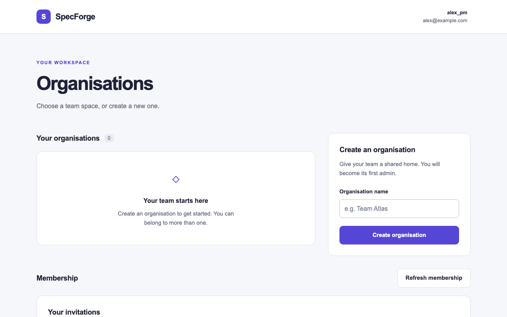
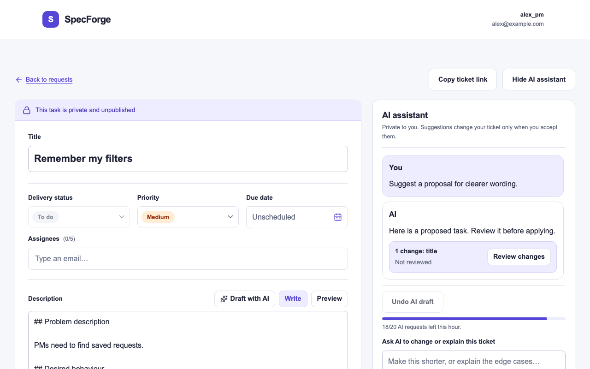
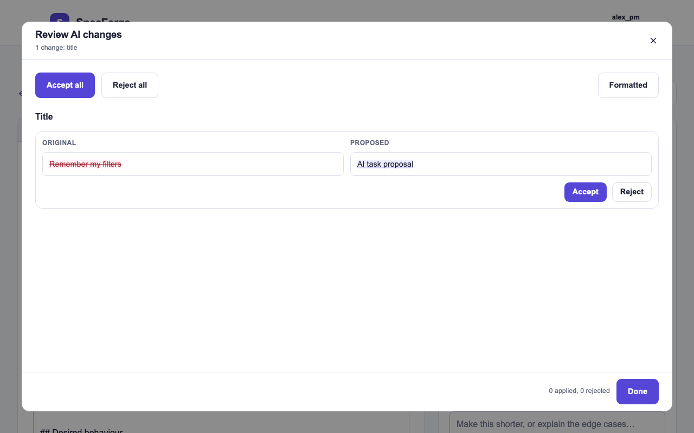
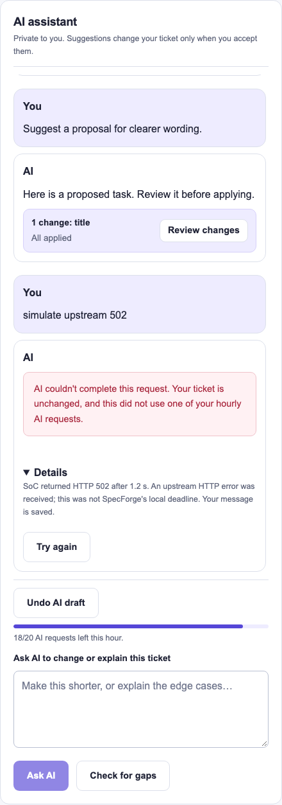
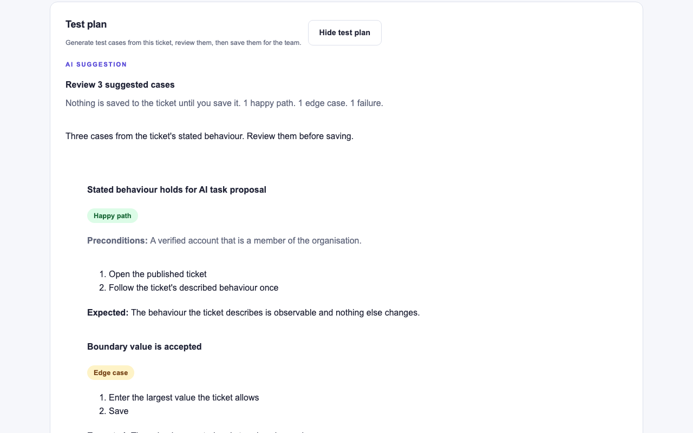
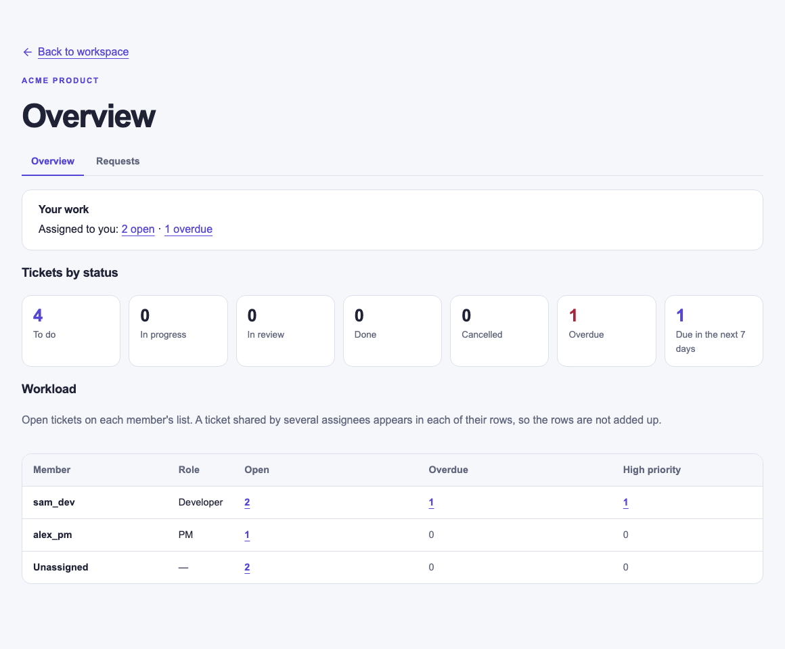

# SpecForge User Guide

SpecForge helps product teams turn rough ideas into clear tickets and test
plans. Product Managers draft and refine tickets with an AI assistant;
Developers pick up published tickets and generate test cases for them.

Open SpecForge at <https://specforge-prod.onrender.com/sign-in>.

## Contents

- [Get started](#get-started): [demo kit](#try-it-with-a-demo-kit) or
  [your own account](#create-an-account)
- [Five-minute walkthrough](#five-minute-walkthrough)
- [Organisations and members](#organisations-and-members)
- [Organisation overview](#organisation-overview)
- [Tickets](#tickets)
- [AI assistant](#ai-assistant) (Product Managers)
- [Test plans](#test-plans) (Developers)
- [Your profile](#your-profile)
- [Troubleshooting](#troubleshooting)

## Get started

SpecForge has two roles, chosen when an account is created:

- **Product Manager (PM):** writes tickets, with help from the AI assistant.
- **Developer:** works on published tickets, updates their status and generates
  test plans.

Anyone can create an organisation and becomes its admin. Admins invite members
and manage who belongs.

If the site takes a moment to load on your first visit, wait a few seconds: it
is waking up.

### Try it with a demo kit

A demo kit gives you two ready-to-use logins, one **Product Manager** and one
**Developer**, without using your own email.

1. On the **Sign in** page, choose **Create demo kit** under **Try SpecForge**.
2. Copy both logins. They are shown **only once**: reloading or leaving the page
   clears them.
3. Sign in with each login in its own browser or private window. As the PM,
   create an organisation and invite the Developer's demo email, then accept the
   invitation as the Developer. The [walkthrough](#five-minute-walkthrough)
   continues from step 4.

Demo accounts work exactly like ordinary accounts. A limited number of kits can
be created at a time; if the page says the limit is reached, it tells you when
to try again, or you can create your own account instead.

### Create an account

1. Choose **Create an account**. Enter a username (3–24 letters, digits or
   underscores), your email address and a password of at least 12 characters.
2. Pick **Product Manager** or **Developer** from **Application role**. Your role
   cannot be changed later.
3. Open the verification email and select its link, then sign in with your email
   and password. If no email arrives within a few minutes, check your spam
   folder, or [use a demo kit](#try-it-with-a-demo-kit).

To sign out, open the account menu (your username, top right) and choose
**Sign out**.

## Five-minute walkthrough

This tour uses both roles. Use two browsers, or one normal and one private
window, so each account stays signed in.

1. **Sign in as both roles.** Use a [demo kit](#try-it-with-a-demo-kit), or
   [create](#create-an-account) one Product Manager and one Developer account.
2. **Create an organisation.** As the PM, enter a name under **Create an
   organisation** and choose **Create organisation**. You become its admin.

   

3. **Invite the Developer.** Choose **Manage** on the organisation card, enter
   the Developer's email under **Invite by email**, and choose **Send
   invitation**. In the Developer's window, choose **Refresh membership**, then
   **Accept** under **Your invitations**.
4. **Draft a ticket with AI.** As the PM, open the organisation and choose
   **New task**. Type a rough idea into **Description**, for example "Remember
   filters when I return to the request list", then choose **Draft with AI**.
   The draft fills the editor; **Undo AI draft** puts your idea back.
5. **Review a change.** Ask the **AI assistant** for an improvement, such as
   "Suggest clearer wording". When its reply shows a change card, choose
   **Review changes**.

   

   The window shows your text beside the proposed text. **Accept** or **Reject**
   each change, or use **Accept all**, then **Done**.

   

   If a request does not go through, the reply says your ticket is unchanged and
   the request is given back to your own allowance. Open **Details** to see why,
   then **Try again**.

   

6. **Publish.** Choose **Publish**. The banner above the title changes from
   private to visible to the organisation's members.
7. **Assign.** In **Assignees**, type part of the Developer's email, pick them
   from the list, and choose **Update** to save the assignment.
8. **Plan the tests.** As the Developer, open the ticket from the organisation's
   Requests table, choose **Show test plan**, then **Generate test cases**.
   Check the cases and choose **Save to ticket**; every member can now see the
   saved plan.

   

## Organisations and members

**Your organisations.** The workspace lists the organisations you belong to.
Select a card to open its **Overview**, and switch to **Requests** with the tabs
under the organisation's name. Select **SpecForge** in the navbar to come back. You can belong to several organisations, and each one's tickets stay
private to its members.

**Inviting.** Admins choose **Manage** on an organisation card, enter an email
under **Invite by email** and choose **Send invitation**. The email does not need
an account yet: once its owner signs up, the invitation is waiting under **Your
invitations** in their workspace, where they can **Accept** or **Decline**
(choose **Refresh membership** to check for new ones). Invitations expire after
seven days; admins can **Resend** or **Cancel invitation** from **Outgoing
invitations**.

**Managing members.** In **Manage**, admins see every member with their role and
can **Promote admin**, **Demote admin** or **Remove member**. Any member can
**Leave organisation**. An organisation always keeps at least one admin, so the
last admin must promote someone else first. Admin status is separate from your
PM or Developer role. Someone who leaves or is removed needs a new invitation to
return.

**AI usage.** In **Manage**, admins also see how many AI requests the
organisation has left today, for example "AI today: 52 of 80 left · resets at
midnight Singapore time". It counts every member's PM assistant and test-plan
requests together. Other members don't see this bar.

## Organisation overview

Every member sees the same read-only summary of the organisation's published
tickets. Private drafts never count, except your own in your summary line.

- **Your work:** how many open tickets are assigned to you and how many of them
  are overdue. Product Managers also see their private drafts.
- **Tickets by status:** one count per status, plus **Overdue** (past its due
  date and not Done or Cancelled) and **Due in the next 7 days**. Each ticket
  counts once, however many people are assigned to it.
- **Workload:** each member's open, overdue and high-priority tickets, then
  **Unassigned**. A ticket shared by two people appears on both their rows, so
  the rows are not meant to be added up.

Select any number to open **Requests** with the matching filters already
applied; a zero is plain text. "Overdue" and "due" use your own calendar day.
Reload the page to refresh the counts.

## Tickets

### Creating and publishing

Product Managers choose **New task** on an organisation's Requests page. A ticket
has a **Title** and a **Description**. Description supports Markdown (headings,
lists, bold, italics and code blocks); use **Preview** to see how it will look
and **Write** to keep editing. Title holds up to 160 characters and Description
up to 3,000; the count in each box's bottom-right corner turns red if you go
over, and the ticket cannot be saved until you shorten it.

A new ticket is a private draft: only you can see it, and it saves automatically
as you type. When it is ready, choose **Publish** to share it with every member
of the organisation. After that, edits stay on your screen until you choose
**Update**, so members always see the last version you saved. You can delete a
draft with **Delete draft**; published tickets stay.

The banner above the title always tells you who can see the ticket. Use **Copy
ticket link** to share it with another member. **About this ticket** shows the
author and when it was created and last saved.

### Due date, priority and assignees

Below the title, the author can set:

- **Due date:** pick a day from the calendar, type a date, or choose **Clear
  date**.
- **Priority:** Low, Medium or High.
- **Assignees:** up to five members. Type part of an email, then pick from the
  list.

### Delivery status

Published tickets have a **Delivery status**: To do, In progress, In review,
Done or Cancelled. The author and the ticket's assignees can change it. Other
members can read the ticket and comment.

### The Requests table

Each organisation's Requests page lists its tickets with **Title**, **Owner**,
**Assignees**, **Status** and **Priority**. Select a title to open a ticket.

- **Search and filter** by title, status, priority or assignee (including
  **Assigned to me** and **Unassigned**), then choose **Apply filters**. Status
  also offers **Open**, **Overdue** and **Due in the next 7 days**. Applied
  filters stay in the page address, so a reload keeps them and you can share the
  link. If a link's filters are not recognised, the defaults are shown instead.
- **Sort** by **Recently updated**, **Due date** or **Status**.
- **Change status or priority** straight from the table, if you are allowed to.
- **Load more tickets** shows the next page.

### Team discussion

Published tickets have a **Team discussion & activity** section where members
post comments. It also records publication, edits and delivery changes, with who
made them and when. **Load older activity** shows earlier entries.

## AI assistant

The AI assistant is for Product Managers and appears beside your own tickets.
Its conversation is private to you, even after the ticket is published.

- **Draft with AI:** write a rough idea in **Description** and choose **Draft
  with AI** to turn it into a full ticket. **Undo AI draft** restores your idea.
- **Ask AI:** ask a question or request a change in the box at the bottom of the
  panel, for example "What is missing from this ticket?". A message can be up
  to 4,000 characters; the box shows your count.

While the AI is responding, **Title** and **Description** are read-only so the
suggestion matches what you see; you can still select and copy text. A reply
that suggests no change says **No ticket changes suggested.**

**Reviewing suggestions.** The AI never edits or publishes your ticket by
itself. Each suggestion appears as a card; choose **Review changes** to see your
text beside the proposed text, then **Accept** or **Reject** each change, or use
**Accept all** or **Reject all**. **Formatted** shows both sides as rendered
Markdown. If you have since edited the part a change refers to, that change is
marked as outdated and the rest stay usable. Always read the suggestions before
accepting or publishing.

**If a request does not go through,** your ticket is unchanged and the request is
given back to your own hourly and daily counts. It still counts toward your
organisation's and SpecForge's limits below. Open **Details** to see why, then
choose **Try again**.

**Usage.** The bar above the instruction box shows how many AI requests you have
left this hour (20 per hour) and today (40 per day, shared with test plans).
When you run low it also shows when the hourly count resets. You can always keep
editing by hand.

**Shared limits.** Your organisation can make 80 AI requests per day in total,
across all members and both AI features. SpecForge also limits total AI use
across the site and pauses briefly when the SoC service is busy. Days reset at
midnight Singapore time. See [AI limit messages](#ai-limit-messages).

Use **Hide AI assistant** and **Show AI assistant** to make more room; your
conversation is kept. On phones the assistant appears below the ticket.

## Test plans

Developers can generate a test plan for any **published** ticket in their
organisation. Open the ticket and choose **Show test plan**.

1. Optionally type a focus note, for example "concentrate on the invitation
   expiry rules".
2. Choose **Generate test cases**. You get up to 12 cases, each with a title, a
   kind (**Happy path**, **Edge case** or **Failure**), any preconditions,
   numbered steps and the expected result.
3. Review the cases, then choose **Save to ticket**, or **Discard** to throw them
   away. Saving again replaces the saved plan.

Every member of the organisation can see the saved plan, along with who saved it
and when. If the ticket changes after a plan was generated, SpecForge asks you to
generate a fresh one so the plan always matches the ticket. Each Developer can
generate up to 20 plans per hour. Plans also count toward your 40 AI requests
per day and your organisation's shared limits (see [AI assistant](#ai-assistant)).

Product Managers see saved plans but do not generate them.

## Your profile

Open the account menu and choose **Profile** to see your username, role, email,
when you joined, and your organisations. To change your username, edit
**Username** and choose **Save changes**. Your new name appears everywhere,
including on existing tickets.

## Troubleshooting

- **Can't sign in:** check your email and password, and make sure you have
  opened the verification link.
- **No verification email:** check your spam folder, or
  [use a demo kit](#try-it-with-a-demo-kit).
- **"Too many attempts":** wait a minute, then try again.
- **"Your session has ended":** choose **Sign in again**. Anything you were typing
  stays on screen; if a ticket was mid-save, choose **Retry draft save** after
  signing in.
- **An invitation or member change didn't work:** choose **Refresh membership**
  and try again. The invitation may have expired or someone else may have made a
  change.
- **A ticket won't save:** your text is kept on screen. Choose **Check saved
  version**, then try again. If someone else saved a newer version, you can
  reload it.
- **"You don't have permission":** your access to that organisation or ticket
  has changed. Ask an admin.
- **An AI request or test plan didn't go through:** nothing changed. Choose **Try
  again** or **Retry generation**.

### AI limit messages

These are expected limits, not errors. Your ticket and test plan are unchanged.

| Message starts with | Why | What to do |
| --- | --- | --- |
| "SpecForge's AI is at capacity right now" | Too many AI requests across SpecForge at once, or SoC asked us to slow down. | Wait the minutes shown, then try again. |
| "SpecForge's AI has reached today's limit" | SpecForge's daily AI total is used up. | Try again after midnight Singapore time. |
| "Your organisation has used today's AI allowance" | Your organisation's 80 requests for today are used. | Try again after midnight Singapore time. An admin can see the count in **Manage**. |
| "You have used today's 40 AI requests" | Your own daily allowance is used. **Ask AI** or **Generate test cases** stays disabled until it resets. | Try again after midnight Singapore time. |
| "SoC is busy right now" (in **Details**) | The SoC AI service turned the request away. | Try again in a minute or two. |

In every case you can keep editing or planning by hand.

